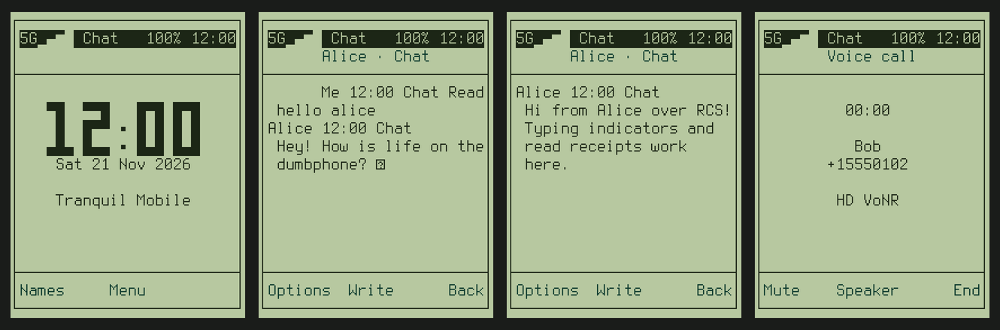

# Tranquility

A dumbphone OS written from scratch in Rust: a small bare-metal aarch64
kernel plus a `no_std` phone stack covering 4G/5G, voice with call audio,
SMS, MMS, RCS chat (1:1 and group, with file transfer) and the usual
feature-phone apps. Data is saved to disk. A web installer flashes it onto
cheap, bootloader-unlockable Android phones over WebUSB. It doesn't use
Linux, Android or any third-party crates.



## Quick start

Requires Rust (stable; `rust-toolchain.toml` pulls the aarch64 target) and
`qemu-system-aarch64` (8.2 or newer for virtio-sound).

```bash
make run          # phone on the serial console (Ctrl-A X to quit)
make run-gui      # phone in a window: keyboard = keypad, sound, saved data
make test         # phone-stack, installer and browser end-to-end tests
make serve        # installer site on http://localhost:8000
```

The SIM PIN is **1234**. Data persists in `build/data.img`. If your machine
has no PulseAudio/PipeWire, use `make run AUDIO=none`.

| Key            | Phone button                   |
|----------------|--------------------------------|
| `0`-`9` `*` `#`| keypad (multi-tap text, `#` changes case/mode) |
| arrows         | d-pad                          |
| Enter          | OK / centre key                |
| Backspace      | Back / clear                   |
| `[` or `]`     | left soft key (Options)        |
| Tab            | green Call key                 |
| `` ` `` or Esc | red End key                    |
| letters        | typed straight into text fields |

## Installing on a phone

`make web` builds a static site in `web/dist`. Deploy it to any HTTPS host,
or use the included GitHub Actions workflow, which publishes it to GitHub
Pages from `main` (enable *Settings → Pages → Source: GitHub Actions*).
Open it in Chrome, Edge or another Chromium browser. The site walks you
through choosing the phone, preparing it and connecting over USB, then
offers four actions:

- **Unlock** — the bootloader, where the phone allows it.
- **Try it** — `fastboot boot`: runs from RAM and writes nothing.
- **Install** — flashes the boot partition of the active slot.
- **Restore** — flashes your stock `boot.img` back.

Each boot image is built in the browser for the selected phone: the kernel
`Image.gz` plus a generated device tree, in the boot-image format that phone
expects.

| Phone | SoC | Unlock |
|---|---|---|
| Google Pixel 3a / 3a XL | SDM670 | easy (`fastboot flashing unlock`; not Verizon units) |
| OnePlus 6 / 6T | SDM845 | easy (`fastboot oem unlock`) |
| SHIFT6mq | SDM845 | easy |
| Fairphone 4 | SM7225 | needs a code from Fairphone |
| Xiaomi Poco F1 | SDM845 | hard (Mi Unlock tool and a waiting period) |

Boot parameters come from postmarketOS `deviceinfo`. Framebuffer, GIC,
board IDs and reserved memory come from the mainline Linux device trees.

### What works on real phones today — read this

**None of this has been run on real hardware yet.** On a phone, the kernel
is designed to:

- boot through the stock bootloader;
- find the display the bootloader left on (`simple-framebuffer`);
- keep its memory out of every reserved firmware region;
- run the interface. With no input driver, it plays a short scripted demo:
  unlocks the SIM, receives a chat, answers a call.

Phone hardware drivers don't exist yet: no modem, touchscreen, buttons,
audio codec or UFS/eMMC storage. Until they do, the phone side is a demo,
and it can't place real calls or send real texts. The modem in particular
is hard: Qualcomm basebands need remoteproc firmware loading and QMI, not
AT commands over a UART.

One more caveat: some phones' bootloaders may not keep the display
refreshing after handing over, especially with command-mode panels. If
*Try it* shows only the boot logo, that's why.

Everything else is exercised in QEMU and in tests:

- **Boot path.** The phone path is tested in QEMU with the exact device tree
  the site generates: GICv3, no serial port, no virtio, display through
  `simple-framebuffer` only.
- **Boot images.** The site's boot images are byte-identical to AOSP
  `mkbootimg` output (header v0, v1 and v2).
- **Device trees.** Every generated device tree passes `dtc`.

## Architecture

```
kernel/            bare-metal aarch64, ~2,100 lines
  boot.rs          arm64 Image header, PIE self-relocation, EL2→EL1, MMU, vectors
  fdt.rs           device-tree parser; platform.rs: discovery + heap placement
  gic.rs           GICv2 and GICv3;  timer.rs: virtual timer tick
  mmu.rs heap.rs   RAM mapping, cache maintenance, size-class allocator
  uart.rs keys.rs  PL011 console (QEMU), terminal → keypad
  fb.rs fwcfg.rs   framebuffer: bootloader simple-framebuffer or QEMU ramfb
  virtio.rs        virtio-mmio v2 + split queues
  vblk.rs vsnd.rs vinput.rs   disk, sound, keyboard
  main.rs          init, event loop, demo autopilot, on-screen panics

phone/             no_std + alloc, host-testable, ~10,000 lines
  at.rs            AT command driver (27.007 / 27.005 + TCP socket commands)
  gsm7.rs sms.rs   GSM 03.38, TS 23.040 PDUs, concatenation, ports, reports
  cb.rs            TS 23.041 cell broadcast (emergency alerts)
  wsp.rs mms.rs    WSP encoding, OMA MMS 1.3, WAP Push
  msg.rs sip.rs    HTTP/SIP framing, SIP helpers, HTTP digest (md5.rs)
  cpim.rs mime.rs  CPIM, IMDN, isComposing, multipart, RFC 5365 lists
  audio.rs         tones, ringtones, DTMF, mixer, simulated far-end voice
  store.rs         snapshot format, A/B CRC-protected block storage
  services/        network, calls, SMS, sockets, HTTP, MMS, RCS, file transfer
  ui/              screens, T9 input, ANSI and framebuffer renderers, font
  sim/             simulated baseband + network (SMSC, MMSC, IMS, FT server)

web/               installer, ~1,100 lines, no dependencies or build step
  lib/fastboot.js  fastboot over WebUSB
  lib/bootimg.js   Android boot image writer (v0–v2)
  lib/dtb.js       device-tree writer
  lib/devices.js   phone profiles;  lib/build.js: DTB + boot.img per phone
  app.js           the page;  test/: node tests;  e2e/: headless Chromium
```

### Features

- **Network.** 4G/5G registration, operator name, signal, battery, network
  time, mode selection (auto, 4G or 5G only), airplane mode, and recovery
  after signal loss.
- **SIM.** PIN unlock with a retry counter.
- **Calls.** Dial, answer, reject, DTMF, mute, speaker, call log, emergency
  calls while locked or in airplane mode. **Audio** includes ringtone,
  North American ringback, busy tone, keypad DTMF tones and the far end's
  voice from the baseband.
- **SMS.** GSM-7 and UCS-2 encoding, long-message concatenation, delivery
  reports.
- **MMS.** Send and receive, including group MMS with reply-all threading.
  Pictures and vCards are supported.
- **RCS chat.** IMS registration with digest auth, capability discovery,
  read receipts and typing indicators. **Group chat** uses pager-mode
  multi-recipient MESSAGE (RFC 5365) with Conversation-ID. **File
  transfer** goes over HTTP: upload, then send the file-info. Chat falls
  back automatically to SMS, MMS or group MMS.
- **Saved data.** Contacts, conversations (attachments included), call log
  and settings, written every 2 s when changed. Two alternating slots with
  CRCs survive a power cut mid-write.
- **Other.** USSD, `*#06#`, cell-broadcast alerts, clock with alarm and
  snooze, stopwatch, calculator, settings, phone status, AT log.

### The simulated network

QEMU has no cellular modem, so `phone::sim::SimModem` plays a UART-attached
LTE/NR module behind the AT interface. Behind it are an SMSC, USSD, cell
broadcast, TCP sockets, an MMSC, an IMS core with an RCS server and
conference factory, and an RCS file-transfer server. Simulated contacts
answer:

| Contact | Number    | Behaviour |
|---------|-----------|-----------|
| Alice   | +15550101 | RCS, replies, sends pictures back, answers calls |
| Bob     | +15550102 | SMS/MMS only, replies, hangs up after 15 s |
| Carol   | +15550103 | RCS, replies, doesn't answer calls |
| Dave    | +15550104 | SMS only, never replies |
| —       | +15550199 | always busy |

**Menu → Network simulator** triggers an incoming call, SMS, chat, MMS,
group chat, emergency alert, signal loss or a long SMS.

### Limits

- **Pager-mode groups only.** Group chat is pager mode. Session-based UP
  group chat (MSRP, conference event package) isn't implemented, and pager
  groups don't carry typing indicators.
- **No TLS.** The phone has no TLS stack, so file transfer and MMS use plain
  HTTP. Real operators require HTTPS for file transfer.
- **Downlink audio only.** No microphone path yet.
- **Simulated network only.** Nothing talks to a real network until there's
  a modem driver.

## Credits

The 8x16 font comes from Terminus Font by Dimitar Zhekov (SIL Open Font
License 1.1); `tools/genfont.py` generates `phone/src/ui/font.rs`.
Device data comes from postmarketOS and the Linux kernel device trees.
